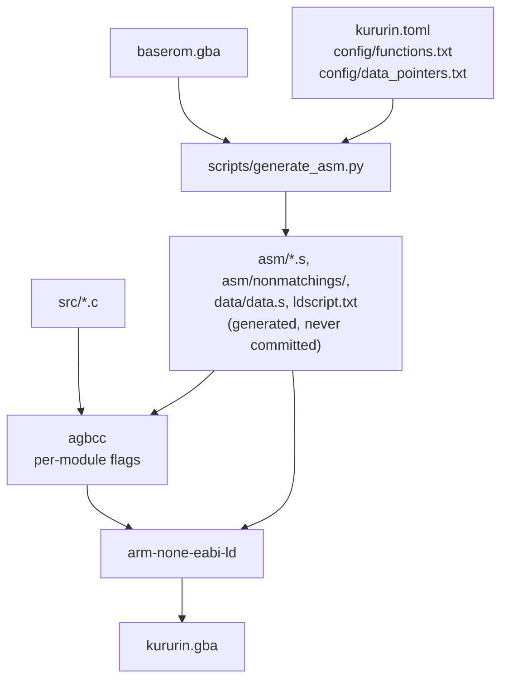
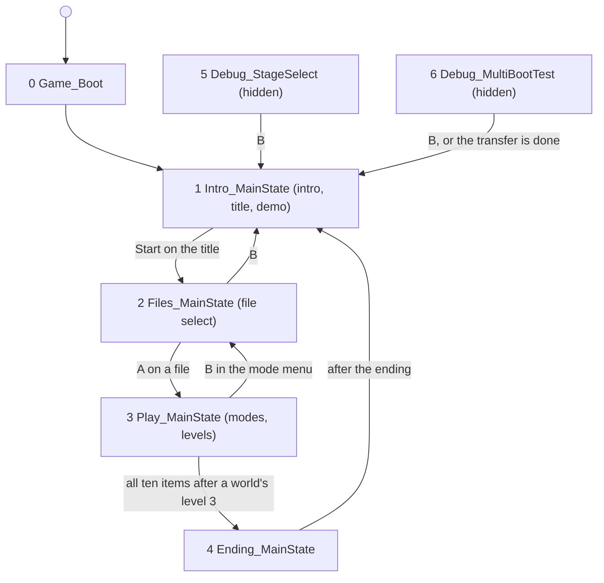
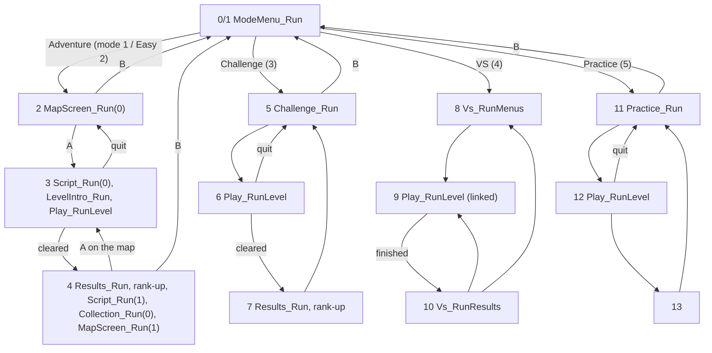
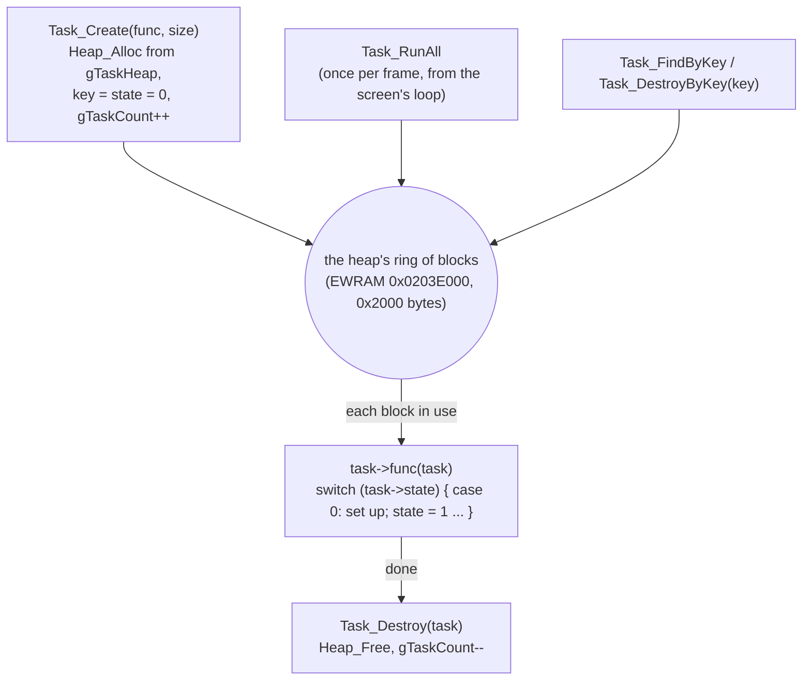

# A guide to the code

A tour of Kuru Kuru Kururin's code for someone new to this repository: how the game is put
together, where each part lives in `src/`, and where to read further. Everything here comes from
the decompiled code (each function has a doc comment written from what it reads, writes and
calls) and the other documents in `docs/`. Where something is not known, it says so.

Names follow [`names.md`](names.md) (`Module_Verb` functions, `gCamelCase` globals); a name that
is still a placeholder (`sub_XXXXXXXX`, `gUnk_XXXXXXXX`, `unkXX`) means its role is not known
yet. Addresses are the original ROM's (`baserom.gba`). Hexadecimal numbers are written as in
the code (`0x...`).

Contents:

1. [Overview](#1-overview)
2. [Boot and main loop](#2-boot-and-main-loop)
3. [The Helirin](#3-the-helirin)
4. [Collision](#4-collision)
5. [Levels](#5-levels)
6. [Game modes](#6-game-modes)
7. [Graphics](#7-graphics)
8. [Sound](#8-sound)
9. [Save data](#9-save-data)
10. [Debug and unused content](#10-debug-and-unused-content)
11. [Status](#11-status)

---

## 1. Overview

### The hardware, as far as it matters here

The Game Boy Advance has an ARM7TDMI CPU at 16.78 MHz. It runs two instruction sets: 32-bit
**ARM** and 16-bit **Thumb**. Almost all of this game is Thumb (423 of 427 functions); the four
ARM routines are in `crt0` (the start vector, the interrupt dispatcher `IntrMain` and two serial
routines). Thumb code runs well from the cartridge's 16-bit bus; ARM code is copied to fast RAM
when it matters (AgbMain copies `IntrMain` to IWRAM).

The memory map the code uses:

| Region | Address | Size | What the game keeps there |
| --- | --- | --- | --- |
| BIOS | 0x00000000 | 16 KiB | the system calls (`CpuSet`, `CpuFastSet`, `MultiBoot`, ...: `libagbsyscall`) |
| **EWRAM** | 0x02000000 | 256 KiB | slow work RAM: the decompression buffer / screen heap (from 0x02000000), the key recorder `gKeyRecording` (0x02039DAC), the save buffer `gSaveData` (0x0203BDAC), the task heap (0x0203E000) |
| **IWRAM** | 0x03000000 | 32 KiB | fast RAM: every global of the game (`gMain` 0x03000DC0, `gGameState` 0x03004420, `gCamera` 0x030043B0, `gHelirins` 0x03004530, ...), the interrupt code and table, the stack |
| I/O | 0x04000000 | | the hardware registers (`include/gba/io_reg.h`) |
| Palette RAM | 0x05000000 | 1 KiB | 256 BG colours, then 256 OBJ (sprite) colours |
| **VRAM** | 0x06000000 | 96 KiB | BG tiles and maps (0x06000000-0x0600FFFF), OBJ tiles (0x06010000-0x06017FFF) |
| OAM | 0x07000000 | 1 KiB | 128 sprite entries and 32 affine (rotation/scale) parameter sets |
| ROM | 0x08000000 | 4 MiB | the code (up to 0x0801CB64), then data: graphics, maps, levels, songs |
| SRAM | 0x0E000000 | 32 KiB | the save (`docs/save_format.md`) |

The screen is 240x160 pixels; a frame is 228 lines (160 visible, then the VBlank period) at
about 59.73 frames a second. The game draws in VBlank: during the frame it prepares copies of
the registers, the sprite table and the tile transfers in RAM, and the VBlank-side code writes
them to the hardware (see [the frame](#a-frame)).

### How the build works

`baserom.gba` (your own dump, never shared) goes in; a ROM that plays the same comes out.



- `kururin.toml` lists the modules in link order with each one's compiler and flags, every
  name (`[renames]` for functions, `[symbols]` for data, each with its evidence) and the data
  regions. `config/functions.txt` is every function's address and size (from
  `scripts/discover_functions.py`).
- `scripts/generate_asm.py` disassembles the ROM (Luvdis) into one `.s` file per function
  (`asm/nonmatchings/<module>/<function>.s`) and cuts the data into `data/data.s`, with every
  pointer in it written as a symbol, so the linker can move code and data.
- Each `src/<module>.c` is compiled with **agbcc**, the GCC 2.95-based compiler Nintendo's SDK
  used (pret's build, unmodified). A function not yet decompiled is an
  `INCLUDE_ASM("asm/nonmatchings/<module>", Name);` line that pulls in its generated assembly.
- The game is a **functional** decompilation: the C must behave exactly like the original,
  not compile to the same bytes. The SDK libraries (m4a, MultiBoot, SIO, SRAM) are kept
  byte-identical.

### How the tests work

`make test` is the verdict for every change (CLAUDE.md, "The gameplay equivalence test"). It
regenerates everything, rebuilds `kururin.gba` from scratch and runs it **side by side with
`baserom.gba`** in mGBA (`tests/gameplay/kurutest.c`), both getting the same keys every frame
from recorded inputs (`tests/gameplay/inputs/`: two TASVideos movies and twelve scripts, some
booting from prepared save files). After every frame it compares the watched RAM
(`tests/gameplay/watch.txt`: the Helirins field by field, `gMain`, `gGameState`, `gCamera`,
...), the SRAM and the audio; every fourth frame the screen. The first difference fails the
test, with screenshots of both ROMs.

`make shift-test` does the same with everything moved by 0x100 bytes, which proves that no
address is hard-coded. `make compare` checks the SHA1 against the original (informational: the
game's C is not byte-identical). The inputs, the harness and the Makefile are locked
(`tests/check_lock.py`).

---

## 2. Boot and main loop

### From power-on to AgbMain

`crt0` (asm) sets up the stacks and jumps to [`AgbMain`](../src/main.c). AgbMain sets the
cartridge wait states, clears EWRAM, IWRAM (up to 0x03007E00), VRAM, OAM and palette RAM with
DMA, copies the interrupt table `gIntrTableInit` to IWRAM (`gIntrTable`) and `IntrMain` next to
it (`gIntrMainBuffer`, installed as the BIOS interrupt vector), turns on the VBlank, DMA and
Game Pak interrupt bits (IE 0x2F01) and the VBlank IRQ in DISPSTAT, and then runs one function
forever:

```c
for (;;)
    gMainStates[gMain.state]();
```

### The main states

`gMain.state` (the byte at 0x03000DCA) picks a **state function** from `gMainStates`
(0x080C28B4). Each state function has its own loop that runs frames until `gMain.state`
changes, then returns to AgbMain, which calls the next one.

| State | Function | What |
| ---: | --- | --- |
| 0 | [`Game_Boot`](../src/level.c) | power-on: the initial `gGameState`, the save buffer, `Save_LoadAtBoot`; then state 1 |
| 1 | [`Intro_MainState`](../src/intro.c) | the intro and the title screen ("PRESS START"); without a key it plays the intro again |
| 2 | [`Files_MainState`](../src/files.c) | the file select, name entry, deleting saved data |
| 3 | [`Play_MainState`](../src/play.c) | everything from the mode menu on: menus, levels, results |
| 4 | [`Ending_MainState`](../src/ending.c) | the ending |
| 5 | [`Debug_StageSelect`](../src/debug.c) | **hidden**: a debug stage select (no code selects it) |
| 6 | [`Debug_MultiBootTest`](../src/debug.c) | **hidden**: a MultiBoot send test (no code selects it) |



States 5 and 6 are only reachable by writing the state byte from outside (an emulator's memory
editor): every store to `gMain.state` in the ROM writes 0-4, except the two inside those
functions. See [section 10](#10-debug-and-unused-content).

Inside a state, `gMain.subState` is the step. `Play_MainState` is the biggest state machine:



Most screens are not separate states but functions with **their own frame loop** that return a
result: `ModeMenu_Run`, `MapScreen_Run`, `Challenge_Run`, `Practice_Run`, `Results_Run`,
`Script_Run`, `Collection_Run`, `LevelIntro_Run`, `Files_EnterName`, `MakeUp_Run`, and the
level itself, [`Play_RunLevel`](../src/play.c). Each of them ends every frame with
`Main_EndFrame`.

### A frame

[`Main_EndFrame`](../src/main.c) ends every frame of every loop:

```
 state function / screen loop                      VBlank interrupt (Main_VBlankIntr)
 ----------------------------                      ----------------------------------
 game logic: tasks, Helirins, menus                stop DMA 0
 Sprite_BuildOam (sprite lists -> gOamBuffer)      m4aSoundVSync (sound DMA)
 Main_QueueCopy/Fill (tile and map transfers)      gMain.intrFlags = 1
            |                                      gMain.vblankCount++
            v
 Main_EndFrame:
   m4aSoundMain()            mix the next sound buffer
   wait until intrFlags bit 0 (set by the VBlank interrupt)
   gMain.frameCallback()     (in VBlank) Main_LinkFrameCallback / Main_FrameCallback:
                               OAM <- gOamBuffer, BG scroll <- gBgLayers,
                               I/O registers <- gDispcntCopy.., run the transfer queue,
                               BG map buffers -> VRAM when dirty
   gMain.frameCount++
   Main_ReadKeys()           heldKeys, newKeys, prevKeys, repeatKeys
```

- **Register copies.** The game never writes most display registers directly during a frame:
  it changes `gDispcntCopy`, `gBgCntCopies`, `gBldyCopy`, `gWin0hCopy`... (0x2B halfwords from
  0x030008F0) and the frame callback copies them to the hardware in VBlank.
- **The frame callback.** `Game_Boot` installs `Main_LinkFrameCallback` (with
  `Main_InstallLinkFrameCallback`): with the serial interrupts on (a linked game) it first
  exchanges this frame's link data (`Link_Exchange`), then does the copies with the BIOS's
  `CpuSet`/`CpuFastSet`; otherwise it does them with DMA 3. `Main_FrameCallback` (installed by
  `Main_InstallFrameCallback`, in parts of the mode menu and the MultiBoot test) always uses the
  BIOS.
- **Keys.** [`Main_ReadKeys`](../src/main.c) reads KEYINPUT (inverted) into `gMain.heldKeys`,
  `newKeys` (down now, not last frame), `prevKeys` and `repeatKeys` (new keys, plus the held ones
  every 4 frames after 20).
- **Timing matters.** Because the frame ends at a VBlank wait, code that is a few cycles slower
  or faster can make a frame end one VBlank later or earlier. `make test` catches this (see
  `docs/audit.md`, Timing).

### The transfer queue

Copies to VRAM and palette RAM are best done in VBlank, so code queues them:
[`Main_QueueCopy`](../src/main.c) (copy *size* bytes), `Main_QueueFill` (fill with a halfword)
and `Main_QueueBlockCopy` (rows of tiles, each to the next 0x400 bytes) add an entry
`{src, dst, size, mode}` to `gTransferQueue` (at most 0x40 entries; `gTransferCount`). The
frame callback runs them all (`Main_RunTransfersDma` with DMA 3, or `Main_RunTransfersBios`
with `CpuSet`/`CpuFastSet`) and empties the queue. A full queue makes the queueing function
return -1 and the copy is dropped.

### The task system

Almost everything that moves on screen besides the Helirin is a **task**: a small struct whose
first word is a function pointer, allocated from the task heap and called once per frame
([`src/task.c`](../src/task.c)).

```c
struct Task {
    void (*func)(struct Task *); // called every frame by Task_RunAll
    u16 key;                     // for Task_FindByKey / Task_DestroyByKey
    u16 state;                   // 0 on creation; the task switches on it
    /* the task's own fields follow (each task has its own struct) */
};
```



- `Task_Init` sets up `gTaskHeap` on EWRAM 0x0203E000 (0x2000 bytes); `Play_RunLevel` calls it
  at every level start, so a level starts with no tasks.
- `Task_Create(func, size)` allocates *size* bytes (the task's own struct) and clears `key` and
  `state`; it returns NULL when the heap is full (callers that fill in fields check for it;
  others just lose the task).
- `Task_RunAll` walks the heap's blocks in ring order and calls each task's `func`. A task
  frees itself with `Task_Destroy` when it is done (an effect that has played its animation, a
  shot that hit a wall).
- `key` lets a task find another: the banners (`Effect_UpdateGoalBanner` and kin) take key 3 and
  first destroy any task with key 3, so only one banner shows at a time.
- KururinTAS's notes call the creation function "CREATE_OBJECT" (0x08004104).

Typical tasks: the level's objects (springs, pistons, ... in `objects.c`), the effects
(`effects.c`: sparks, banners, fades, palette and tile animations), the bonuses (`bonus.c`), the
HUD's life icons (`hud.c`), the intro's and the ending's sprites, the map screen's markers.

Most tasks use an **animation** helper: `struct Anim { const u16 *next; u16 timer; u16 value; }`
steps through `{frames, value}` pairs ([`Anim_Start`, `Anim_Step`](../src/util.c)): `Anim_Step`
returns 0 while a frame lasts, non-zero on a new frame (bit 0 set: copy the new tiles) and -1 at
the end; a negative frame count loops back.

### The heap

[`Heap_Init`, `Heap_Alloc`, `Heap_Free`](../src/main.c) are a small first-fit allocator: a ring
of blocks, each with a 0x10-byte header `{next, prev, size, used}`, a head block that never
frees, and a rover where the next search starts. `Heap_Alloc` rounds up to a word, splits a
block with more than 0x13 bytes to spare and clears the memory; `Heap_Free` merges a freed block
with free neighbours.

There are two heaps: the task heap (`gTaskHeap`, above) and `gMain.heap`, which the screens
(intro, ending, map screen, level intro, collection, scripts) set up on the EWRAM from
0x02000000 (0x36B9C bytes) for their decompressed graphics. During a level that EWRAM is
instead the level's decompression buffer (`gMain.ewramCursor`, `Level_Load`).

---

## 3. The Helirin

The player is the **Helirin**, a stick that spins all the time and must be steered through
narrow corridors without touching the walls. There are four Helirin structs (`gHelirins`,
0x03004530, 0xCC bytes each, `struct Helirin` in
[`include/variables.h`](../include/variables.h)): `gHelirins[0]` is the player; in Training
`gHelirins[1]` is the instructor; in the linked game each console's player is one of the four.
`gGameState.helirin` points to the current player's. The field names come from KururinTAS's
memory watch and physics notes (`Misc/Game_analysis/kkk.txt`).

All code is in [`src/helirin.c`](../src/helirin.c). Every frame of play, `Play_RunLevel` calls,
for the player's Helirin:

1. [`Helirin_Update`](../src/helirin.c): keys, movement, rotation, the tile under it.
2. `Task_RunAll`: the objects and effects (they may push the Helirin).
3. [`Helirin_UpdateCollision`](../src/helirin.c): collision with the walls and its response.
4. [`Helirin_Draw`](../src/helirin.c).

### Positions and angles

Positions (`x`, `y`) are 16.16 fixed point (the pixel is the high halfword, `POS_PIXEL`).
Angles are 16-bit, a full turn being 0x10000; directions used for tables are bytes (a full turn
256), and `gSineTable`/`gCosineTable` give the step for each byte direction (direction 0 is up:
x uses sine, y subtracts cosine).

### Rotation

`angle` advances by `angleRate` every frame. `angleRate` moves towards `angleDefaultRate` by
`angleRateStep` (0x5B a frame, `Util_StepTowards`), so after a bump the spin speed returns to
normal. A Helirin starts spinning at 0xB6 (`Helirin_ResetToStart`), or the other way when the
level's start tile says so (`gCamera.ccwStarts`). A wall hit reverses the spin: `nextAngleRate`
becomes +/-0x400 against the current direction. A spring sets `nextAngleDefaultRate =
-angleDefaultRate`, which reverses the default direction (KururinTAS: "Turn rate (at sleep)").

### Movement and speed

The D-pad gives a direction (`gKeyDirections`, 8 directions); while it is held, the Helirin
moves by `speedNorm` along it (`xs`, `ys` are this frame's input step):

| Keys | `speedNorm` | Pixels a frame |
| --- | --- | ---: |
| D-pad only | 0x180 | 1.5 |
| D-pad + A or B | 0x240 | 2.25 |
| D-pad + A + B | 0x300 | 3 |
| no D-pad | 0 | 0 |

(The step is `gSineTable[dir] * speedNorm`, the table being 256 for a whole step: 0x180 * 256 =
0x18000, 1.5 pixels in 16.16.)

On top of that, `xb`/`yb` are the **bump** velocity (set by `Helirin_Bump`: a wall, a spring,
a piston, a shot), added every frame and decaying to 3/4 each frame. The speed-up keys also play
sounds (songs 0x30-0x33). R and L only play sounds (0x41-0x46) and set `flags` bit 26, which
Select's size change sets too (what reads it is not worked out).

### Input handling

`Helirin_Update` copies the keys into the Helirin's own `keys[5]` (held, previous, new,
repeated, the repeat timer), so that each Helirin can have its own input source:

- normally `gMain.heldKeys`;
- in a **demo** (`flags` bit 16, from `GAME_FLAG_DEMO`, and for Training's instructor
  Helirin): replayed from `demoKeys`, one byte a frame (D-pad in the high nibble, A/B in bits
  0-1, 0xFF at the end) from `gDemoKeys` at the level's offset in `gDemoKeyOffsets` (Practice's
  "See Demo", the debug PLAYBACK);
- with **recording** on (`flags` bit 17, only from the debug stage select): also written to
  `gKeyRecording` (EWRAM 0x02039DAC) in the same format;
- `disableFlags` bit 1 ignores input (a linked game until its countdown ends, the debug MAP
  TEST).

### Damage and lives

When a point of the Helirin touches a wall (or an object reports a hit through
`objectCollisionMask`), [`Helirin_UpdateCollision`](../src/helirin.c):

- plays sound 0x34 (0x35 inside a zone or after the goal), starts up to two spark tasks at the
  hit points (`Effect_UpdateHitSpark`, or `Effect_UpdateZoneHitRipple` in a zone);
- undoes this frame's input move, pushes the Helirin away from the wall (`Helirin_Bump` along
  the stick's direction, 0x200; plus 0x400 against the input direction when both halves or the
  centre touch) and reverses its spin;
- unless it is invulnerable or in a zone/at the goal (`flags & 0x40008`): one **life** less,
  20 frames of `invulnerability`, `bumpCount + 1` (up to 99) and, except in the linked game,
  **3 seconds** (0xB4 frames) added to the `timer` (`Effect_UpdateTimePenalty` shows it). At 0
  lives the Helirin crashes (`flags` bit 6): `Helirin_Update` starts the crash animation
  (`Effect_UpdateCrash`) and sixteen flying pieces (`Helirin_UpdatePiece`).

The number of lives comes from the mode ([`Lives_Init`](../src/makeup.c), `gLivesSettings`):
3 in Adventure and Practice, 2 in Challenge, 1 each in the linked game (the ROM's defaults,
`gDefaultLivesSettings`). The HUD shows them as hearts (`Hud_Draw`, `Hud_UpdateLifeIcon`) next
to a face whose expression follows the lives (`gHudFaceAnims[maxLives][lives]`).

### Zones

The tile under the Helirin's centre (in the level's first layer, `gWallMap`) is checked every
frame:

| Tile | What | Effect |
| --- | --- | --- |
| 0xEA-0xEF | **healing zones** (0xED-0xEF are also the start points of areas 1-3) | refill lives to `maxLives` on each entry (sound 0x37, a colour flash), no damage inside; `flags` bits 19-24, two per zone pair (0xEA/0xED, 0xEB/0xEE, 0xEC/0xEF), record the visit (`Play_CheckLevelEnd` reads bits 19/21/23 by `gGameState.area`; their exact use is not worked out) |
| 0xF2 (where its pixel is set), 0xFB-0xFD | **start zones** | the same refill; `progress` reset |
| 0xF3 (pixel), 0xFE, 0xFF | the **goal** | `flags` bits 2 and 3: the level end starts (`Play_CheckLevelEnd`) |
| 0xA0-0xBF | progress markers | `progress` 1-0x20 (shown in the linked game's progress bar) |

**Select** changes the Helirin's size (`Helirin_SetSize`) inside a start zone in Adventure,
Easy, Challenge, Practice and debug play, and inside a healing zone in Practice and debug play
only: each press steps to the next size of the mode's range (Normal sizes 0, 2, 4; Easy 5, 8,
11; Challenge and debug play every size). In Practice
(`gGameState.mode == 5`) the lives also refill slowly outside zones (`regenTimer`, +0x44 a
frame, a life at 0x1000).

### Size, type, colour and the unlocks

- **Size** (`size`, 0-14): the stick's length, from 64 down to 8 pixels, with 17 down to 3
  collision points (`gHelirinSizes`). Normal mode uses size 0, Easy mode size 5 (a shorter
  stick); `Helirin_SetSize` copies the right OBJ tiles.
- **Type** (`type`, 0-14) and **colour** (`color`, 0-6) are chosen in the Make Up screen and
  stored in the save file; `Helirin_Draw` copies the type's palette row for the colour.
  `colorAnim` animates the palette (a flash when hurt, `gHelirinHurtColorAnim`; healed,
  `gHelirinHealColorAnim`; inside a zone, `gHelirinZoneColorAnim`).
- **Unlocks.** Each of the 30 levels of worlds 1-10 holds one bonus. The level map names it
  (`LevelMap_Read`): numbers 1-10 an **item** (`Bonus_UpdateItem`), 11-16 a **colour**
  (`Bonus_UpdateColor`), 21-34 a **type** (`Bonus_UpdateType`). In this ROM: level 1 of worlds
  1-6 has a colour, level 2 of worlds 1-10 and level 1 of worlds 7-10 a type, level 3 of each
  world an item (10 items, 6 colours, 14 types). Touching the bonus swaps the Helirin's colour or
  type with it for a while (or the item starts following the Helirin, `Bonus_UpdateWornItem`),
  sets `GAME_FLAG_BONUS_TAKEN`, and after the level `Results_Run` sets the bit in the save
  file's `unlocks` (bits 0-9 items, 10-16 colours, 17-31 types). The ten items are worn in Make
  Up; all ten, after level 3 of a world, start the ending. The code and data are in
  [`src/bonus.c`](../src/bonus.c); the save bits in [`save_format.md`](save_format.md).

---

## 4. Collision

Code: [`src/collision.c`](../src/collision.c) (KururinTAS's "Collision Test", 0x08013D0C).

### The collision points

The Helirin is not tested as a shape but as a row of **points along its stick**
(`points[17]`): [`Collision_UpdatePoints`](../src/collision.c) places point *i* at
`pointDistances[i]` pixels from the centre in the direction of `angle` (both ends, and the
centre), and records the box of the two ends (`minX`..`maxY`). The number of points depends on
the size (`numPoints`, 17 for the longest stick, 3 for the shortest).

### Map tiles and physical tiles

The level's first layer (`gWallMap`, `gMaps[1]`) is a grid of 16-bit entries: bits 0-9 a tile
number, bits 10 and 11 a horizontal and vertical flip. The tile numbers mean (KuruTools'
`PhysicalMapLogic.cs` and the code):

| Tile ids | Meaning |
| --- | --- |
| 0 | empty |
| 0x01-0x9F | **walls**: a physical tile with per-pixel collision |
| 0xA0-0xBF | progress markers (see zones) |
| 0xE0-0xE9 | digits: numbers written in the map (object parameters, the bonus) |
| 0xEA-0xEF | healing zones |
| 0xF0, 0xF1, 0xF4-0xF9 | object codes and markers (see [objects](#objects)) |
| 0xF2, 0xFB-0xFD | start zones (0xFB/0xFC the start point, 0xFC counter-clockwise) |
| 0xF3, 0xFE, 0xFF | goal (0xFF also the goal position) |

A **physical tile** (`gPhysicalTiles`, 0x2000 bytes; the Challenge world has its own,
`gPhysicalTilesChallenge`) is 8x8 pixels of 4 bits each, one `u32` per row.
[`Collision_GetTilePixel`](../src/collision.c) returns the 4-bit value of a map pixel (wrapping
around the map, applying the flips); [`Collision_TestWallPixel`](../src/collision.c) does that
only for tiles 1-0x9F, so every other tile is empty for collision.

### Detecting a hit

```
for each point i of the Helirin (0 .. numPoints-1):
    if Collision_TestWallPixel(gWallMap, points[i].x, points[i].y) != 0:
        collisionMask |= 1 << i
mask = collisionMask | objectCollisionMask      # objects add their own hits
if mask and not disableFlags bit 0: damage + response (section 3)
```

The response uses which points hit. Point 0 is the centre; then they alternate between the two
halves of the stick, outwards (distances 0, -4, 4, -8, 8, ... for the longest stick): the even
points 2, 4, ... (`collisionMask & 0x15554`) lie on the side the angle points to, the odd ones
(`& 0xAAAA`) on the other. Hits on one half only push the Helirin along the stick away from that
half (0x200); hits on both halves, or on the points 0-2 near the centre, also push it back
against the input direction (0x400).

Objects test the other way round: [`Collision_TestShapes`](../src/collision.c) and
`Collision_FindPointInShapes` check the Helirin's points against a list of shapes
(`struct CollisionShape`: rectangles and circles relative to the object), after a quick test of
the Helirin's box against the shape's.

---

## 5. Levels

### Worlds and levels

`gWorldEntries` (0x080C2E68, KuruTools `Levels.cs`) has 13 worlds, each `{WorldInfo *, data,
tile animations}`:

| World | Levels | What |
| ---: | --- | --- |
| 0 | 5 | Training |
| 1-10 | 3 each | Grass, Ocean, Jungle, Cake, Cave, Cloud, Star, Ice, Machine, Ghost |
| 11 | 3 | The Last Land (opened by flag bit 1, every level of 1-10 without a bump) |
| 12 | 55 | the Challenge courses |

`gGameState.world` and `.level` (0-based) select the level; a **level index** (0-92: Training
0-4, worlds 1-11 from 5, Challenge from 38) numbers them for the save data and the records
(`Level_SetFromIndex`, [`save_format.md`](save_format.md)). The debug stage select also knows a
world 13, "TEST": it reads a 14th entry after the table, which is all zero.

### Map and tile format

A `WorldInfo` holds offsets into the world's data for its graphics tiles, background tiles,
palettes (a separate one for Practice), colour sets for palette cycling, and then a
`LevelEntry` per level: four layers `{offset, size}`, each LZ-compressed:

| Layer | Content | Goes to |
| --- | --- | --- |
| 0 | level data: the walls and codes (`u16 width, height`, then the tiles) | `gMaps[1]` = `gWallMap`, BG 1 |
| 1 | graphical layer | `gMaps[2]` |
| 2 | background | `gMaps[3]` |
| 3 | minimap | the menus (map screen, Challenge, Practice) |

[`Level_Load`](../src/level.c) decompresses the world's tiles and palette into EWRAM, queues
them to VRAM, copies the physical tiles and the sprite graphics, then decompresses the three
layers into `gMaps[1..3]` (`Bg_InitMap`). The maps are larger than the 32x32-tile hardware
layers: [`Bg_ScrollMap`](../src/bg.c) redraws the visible 32x21 tiles into the layer's buffer
whenever the camera moves.

The compression is the game's own LZ ([`Decompress_LZ`](../src/decompress.c), KuruTools
`LzCompression.cs`): a byte 0-0x7F copies that many + 1 literal bytes, 0x80 + n copies n + 3
bytes from a distance (the next byte) back.

### Starting a level

[`Level_StartTasks`](../src/level.c) starts the level's tasks: the opening circle window
(`Effect_OpenWindow`), the world's animated tiles (`Effect_AnimateBlockCopies`), the goal
(`Effect_UpdateGoal`), the palette cycle (`Effect_CyclePalette`), the world's song, and then
[`LevelMap_Read`](../src/level_map.c), which scans the level map:

- the start points (0xFB/0xFC, and 0xED-0xEF for areas 1-3) and the goal (0xFF) into
  `gCamera`;
- the **camera bounds**: the extent of the wall tiles 1-0x9F;
- the bonus (worlds 1-10, from the number at the start of the map, unless already taken);
- the **objects**, each with its parameters in the digits that follow the code (or in the rows
  below it); code 0xF0 starts the objects of the 0xF1 marker it names
  ([`LevelMap_StartMarkedObject`](../src/level_map.c)).

### Objects

All in [`src/objects.c`](../src/objects.c); each is a task (parameters: KuruTools'
`KuruKuruKururin.md`, "Special Objects"):

| Code | Object | Function | What it does |
| --- | --- | --- | --- |
| 0xF8 | spring up / down (flipped) | `Object_SpringUp`, `Object_SpringDown` | bumps the Helirin (`Helirin_Bump` at 0x100) and, when it turns towards the spring, reverses its default spin |
| 0xF9 | spring right / left (flipped) | `Object_SpringRight`, `Object_SpringLeft` | the same, turned by a quarter |
| 0xF7 | Roller | `Object_Roller` | every *period* frames fires an `Object_RollerProjectile` that rolls until it hits a wall |
| 0xF6 | Roller Catcher | `Object_RollerCatcher` | a turned sprite (where the rollers end) |
| 0xF5 | Piston | `Object_Piston` | swings back and forth along a direction, pushing the Helirin (0x300) and turning it |
| 0xF4 | Shooter | `Object_Shooter` | turns towards the Helirin (within an arc) and fires `Object_ShooterShot`s |

These are all the kinds `LevelMap_Read` starts (KuruTools' names: Roller, Roller Catcher,
Piston, Shooter; the springs from KururinTAS's `spring.txt`); a "turret" is a Shooter, and there
is no separate spinner or swinger object in the code. A hit by an object adds the hit points to
the Helirin's `objectCollisionMask`, so it costs a life like a wall.

### Camera

The camera origin `gCameraX`/`gCameraY` (the map pixel at the screen's top left) is set by
[`Camera_Update`](../src/results.c) every frame: centred on the current Helirin (120, 80 pixels
up and left of it), clamped to `gCamera.boundLeft..boundBottom`, and the three maps scrolled to
it (the background at 3/4 or 1/2 speed by world: parallax). With `gGameState.flags` bit 0 (the
pause menu's **See Map**, or the debug MAP TEST) the D-pad moves the camera instead (2 pixels a
frame, 4 with A, doubled with B). `Camera_Update` sits in `results.c` only because of where it
is in the ROM ([`modules.md`](modules.md), Not clean).

### Minimap

Each level's fourth layer is a small picture of the level, shown by the map screen, Challenge
and Practice. `Bg_DrawLevelMinimap` can draw one from the level data instead for a level
without one, but every level in this ROM has one, so that path never runs (its C is reviewed
against the asm, not tested: [`audit.md`](audit.md)).

### The goal and the end of a level

Reaching a goal tile sets the Helirin's `flags` bits 2 and 3. [`Play_CheckLevelEnd`](../src/play.c)
then moves the Helirin to the goal position, shows the goal banner (`Effect_UpdateGoalBanner`)
while `Effect_UpdateGoal` plays the goal's palette animation and fireworks (`Effect_Firework`;
more of them without bumps), and closes the screen with a shrinking circle window
(`Bg_DrawWindowCircle` computes the window's span per line; `Bg_WindowLineIntr` has HBlank DMA
write them to WIN0H line by line). A crash ends the level
the same way, without the goal. The level's timer (`Helirin.timer`, copied to
`gGameState.timer`) counts frames up to 0x34BBF (just under an hour).

After a cleared level, `Results_EnterRecord` and [`Results_Run`](../src/results.c) record the
time, mark the level (cleared, cleared without a bump, ...) and show the result over the level;
`Results_CheckRankUp` raises the save file's rank when every best time beats the rank's times.

---

## 6. Game modes

`gGameState.mode` says what is being played (set by the mode menu, `ModeMenu_Run` in
[`src/mode_menu.c`](../src/mode_menu.c)):

| Mode | What | Code |
| ---: | --- | --- |
| 1 | **Adventure**, Normal | `Play_MainState` sub-states 2-4, [`MapScreen_Run`](../src/mode_menu.c) |
| 2 | Adventure, **Easy** (shorter Helirin, its own records and target times) | the same |
| 3 | **Challenge** | [`Challenge_Run`](../src/challenge.c) |
| 4 | **VS**, the linked game | [`src/vs.c`](../src/vs.c) |
| 5 | **Practice** | [`Practice_Run`](../src/practice.c) |
| 6 | debug play (the debug stage select) | [`src/debug.c`](../src/debug.c) |
| 7 | **Make Up** (set while its screen runs) | [`MakeUp_Run`](../src/makeup.c) |

- **Adventure** starts with the story (`Script_Run(2)`, the first time) and **Training**:
  world 0's five levels are the first five levels of the Adventure map, with an instructor
  Helirin (`gHelirins[1]`, driven by demo keys) beside the player. The story's second choice
  ("skip training", `Script_SkipTrainingMenuItem`) marks Training as skipped. Before a level,
  `LevelIntro_Run` shows the level's card (for the first level of worlds 1-10 a picture and its
  animation) and `LevelIntro_PlayStartAnim` the start animation. After a level: the result,
  the rank-up, `Script_Run(1)` and the bonus collection screen ([`Collection_Run`](../src/collection.c)).
- **Easy** is chosen once per file (the mode menu asks Normal or Easy) and sets the file's flag
  bit 4: mode 2, Helirin size 5, the Easy records and times (`gEasyLevelTimes`).
- **Challenge**: the 55 courses of world 12 in rows of five (11 rows once every course of the
  first 50 is cleared without a bump), 2 lives.
- **Practice** (once Training 5 has a mark): the map of Adventure, then an **area** (each level
  is split into up to four areas, starting at its healing zones: `gLevelAreaCounts`); lives
  regenerate; Select in a zone changes the size; the pause menu offers **See Demo**, a recorded
  run of the area (`Pause_PracticeMenuItem`, `Pause_DemoMenuItem`).
- **Make Up** (item 5 of the mode menu, [`MakeUp_Run`](../src/makeup.c)): choose the Helirin's
  type, colour and worn items among the unlocked ones; also reachable from the pause menu
  (`Pause_MakeUp`, L and R).
- **The pause menu** ([`Pause_Update`](../src/pause.c)): Start in modes 1, 2, 3 and 5; See Map
  (free camera), Play Again, Make Up, Quit.
- **The ending** (main state 4, [`Ending_MainState`](../src/ending.c)): after the collection
  screen, scrolling backgrounds and sprites with the ending's text bouncing in letter by letter
  (`Ending_UpdateText`, `Ending_UpdateLetter`); at its end the file's flag bit 5 is saved.
- **VS / link** (mode 4; what is known): two to four consoles over the link cable. The mode
  menu either waits for a link partner or sends consoles without the cartridge a small loader by
  the BIOS's MultiBoot (`gMultiBootProgram`), which then receives the real guest program in
  0x7200-byte pieces over SIO32 (`ModeMenu_Run`, `gDebugMultiBootImage`; how the guest program
  plays was not looked at). The game itself runs the serial port in
  multi-player mode (115200 bps, [`Link_Init`](../src/link.c)); each frame `Link_Exchange` sends
  and receives a packet per player (`Link_Send`, `Link_Receive`) with the Helirins' positions,
  angles, progress and flags (`Play_RunLevel`), checked by `Vs_CheckLevelLink` ("ID ERROR!",
  "TIME OUT!"). The courses are the Challenge's, in a shuffled order (`Vs_ShuffleCourses`); a
  countdown starts each one (`Effect_UpdateLinkCountdown`), a progress bar shows everyone
  (`Hud_DrawLinkProgress`), and `Vs_RunResults` shows the results. `make test` runs one console,
  so none of this is tested; its menus are `Vs_MatchMenuItem` (rounds or the course list),
  `Vs_CourseRowsMenuItem`, `Vs_CourseListMenuItem` and `Vs_PlayerSettingsItem`, and the
  link-only functions that do not byte-match
  (`Vs_RunMenus`, `Vs_RunResults`, its menus, `Link_Receive`, ...) are C reviewed against the
  asm ([`audit.md`](audit.md), final C pass).

---

## 7. Graphics

### Backgrounds

[`src/bg.c`](../src/bg.c). [`Bg_SetVideoMode`](../src/bg.c) sets one of ten layouts (0-9: which
layers are on, their tile and map VRAM, blending; mode 1 is a level's) into the register copies
and `gBgLayers` (one `struct BgLayer` per hardware layer: scroll, map and tile VRAM, a 0x800-byte
map buffer and a dirty flag). A `struct Map` (`gMaps[4]`) is a tile map of any size drawn through
a layer: `Bg_InitMap`, then `Bg_ScrollMap` (wrapping) or `Bg_ScrollMapClamped` (blank outside)
redraws the visible part into the layer's buffer, which the frame callback copies to VRAM.
`Bg_LoadScreen` sets up the backgrounds of each menu screen (0-18), `Bg_LoadMap`/`Bg_LoadMap8bpp`
load a compressed map and its tiles, `Bg_LoadPicture` a full-screen 8bpp picture.

Effects on the backgrounds: the circle window (`Bg_StartWindowCircle`, `Bg_DrawWindowCircle`),
fades through BLDY (`Effect_BrightnessUp`/`Down`), the rotating BG 2 (`Effect_RotateBg2`),
palette cycles and animated tiles (`Effect_CyclePalette`, `Effect_AnimateCopies`,
`Effect_AnimateBlockCopies`).

### Sprites and OAM

[`src/sprite.c`](../src/sprite.c). Sprites are rebuilt from scratch every frame:

- `Sprite_ClearLists` empties the **16 sprite lists** (`gSpriteLists`) at the start of a frame.
- `Sprite_Alloc(list)` hands out one of 128 entries (`gSprites`) and pushes it onto a list;
  the caller fills its OAM attributes. The list is the drawing order: `Sprite_BuildOam` writes
  list 0 first, and among sprites of the same priority the earlier OAM entry is on top (text uses
  list 1, the HUD and effects 3-4, objects 5, the Helirin 6-7).
- `Sprite_AllocAffine` hands out one of 32 affine parameter sets (`gAffineParams`; 0-7 are fixed
  rotations by eighths, `Sprite_InitRotations`) and `Sprite_SetAffineRotation` fills it, for
  rotated sprites (the Helirin, springs, shooters).
- `Sprite_BuildOam` writes the lists in order into `gOamBuffer`, hides the rest and stores the
  affine sets; the frame callback copies it to OAM.

Sprite tiles are copied to OBJ VRAM by the transfer queue, usually when an animation frame
changes (`TileCopy` lists, `Anim_Step`'s bit 0).

### Palettes

BG palettes come with the world (`Level_Load`) or the screen; OBJ palettes from
`gLevelSpritePalettes` and the screens. The Helirin's palette row is copied when its colour
animation asks for it (`Helirin_Draw`, `flags` bit 7). The screen fades seen in this guide use
the BLDY register (brightness: `Effect_BrightnessUp`/`Down`).

### Decompression

LZ ([`Decompress_LZ`](../src/decompress.c)) for nearly everything (level layers, tiles, maps,
palettes, the intro's pictures); a run-length variant (`Decompress_RLE`) exists but nothing calls
it.

### Text and font

[`src/text.c`](../src/text.c). All text is drawn with **sprites**, not on a background:

- `Text_Draw` (8x16 characters, tile 0xE0 + 2 * c) and `Text_DrawSmall` (8x8, tile c - 0x20);
  `Text_Print`/`Text_PrintSmall` draw at the cursor `gTextCursor` with '\n' and '#' escapes
  (`#h`/`#k`: hiragana/katakana, `#p`: palette); `Text_DrawName` and the `*Proportional`
  variants space lower-case letters by their widths (`gFontWidths`).
- The character set is the game's own: ASCII-like for the Latin letters, kana in 0x80-0xFF with
  the dakuten/handakuten marks 0xDE/0xDF combined through `gDakutenChars`/`gHandakutenChars`, and
  digits 0xE0-0xE9 in the level maps.
- Numbers and times: `Text_FormatTime` (MM'SS"CC at 60 frames a second, the hundredths from
  `gFrameHundredths`), `Text_DrawTime`, `Text_DrawDigits` (the HUD's digit font), `Text_DrawNumber*`.
- The menus all use one driver ([`src/menu.c`](../src/menu.c)): a `struct Menu` with a current
  item and a **menu function** that `Menu_Run` calls with the current item (to handle keys), then
  0xFFFF (the cursor), 0x100 (set up), 0x101.. (draw each item) and 0x1FF (finish). The key
  helpers (`Menu_MoveWrap`, `Menu_StepValue`...) play song 0x20 when the selection moves.

---

## 8. Sound

The sound engine is Nintendo's **MusicPlayer2000** ("m4a"), linked from the SDK:
[`src/m4a.c`](../src/m4a.c) (C, byte-identical to the SDK build, adapted from pret's
`m4a.c`) and `m4a_1.s` (asm, the mixer). Its RAM: `gSoundInfo` (0x03004880) and the music
players (`gMPlayInfo_BGM`, `gMPlayInfo_SE2`, ...); its data: `gSongTable` (0x08021088), the
songs and the instrument voice groups in ROM.

How the game drives it:

- Every frame `Main_EndFrame` calls `m4aSoundMain` (mixes the next buffer) and the VBlank
  interrupt calls `m4aSoundVSync` (restarts the sound DMA).
- Songs and sound effects are started by number: `m4aSongNumStart(n)` directly for effects
  (0x20 menu move, 0x21 confirm, 0x22 back, 0x30-0x33 speed, 0x34/0x35 bumps, 0x36 spring,
  0x37 heal, ...), or [`Sound_PlaySong`](../src/sound.c), which first changes the sound mode
  (`m4aSoundMode`, from `gSongSoundModes[song]`) when the song needs a different number of
  channels.
- The level's music is `gGameState.song`, chosen by world in `Level_StartTasks`; the pause menu
  stops and restarts it, the level end fades it out (`m4aMPlayFadeOut`).
- Delayed starts are tasks (`Sound_UpdateDelayedSong`, `Sound_UpdateSongAfterPlayer`).

`make test` hashes the audio of every frame, so the sound must be identical.

---

## 9. Save data

The game uses the SDK's SRAM library (`src/agb_sram.c`). The save is 0x44C0 bytes of the
32 KiB SRAM: a signature (`"KURURIN 1.01"`), the bank in use, two checksums, and **two banks**
of 0x2254 bytes, written alternately so that a failed save leaves the other intact
([`Save_Write`](../src/save.c)). A bank holds five save files (0x1F4 bytes each: name, rank,
flags, unlocks, Helirin type/colour/items, bonus taken, best time and mark per level) and the
three records of every level (Normal and Easy). In RAM it is `gSaveData` (EWRAM 0x0203BDAC);
`gGameState.saveFile` points to the file in use. [`Save_LoadAtBoot`](../src/save.c) checks the
signature and checksums at boot (and with A+B+Select+Start held, offers to erase everything).

The full format, with the evidence for every field: [`save_format.md`](save_format.md).
`tools/make_save.py` builds save images in that format for the tests.

---

## 10. Debug and unused content

- **Main state 5, the debug stage select** (`Debug_StageSelect`, C reviewed against the asm, and
  `Debug_StageSelectItem`): any world (Z = Training, A-K, MINI = Challenge, TEST = an empty
  world 13) and stage, in four modes: GAME START (play without dying, Select+Start to leave),
  MAP TEST (a free camera), RECORDING (records the keys to EWRAM 0x02039DAC, the format of the
  game's demos) and PLAYBACK (plays a demo of the ROM).
- **Main state 6, the MultiBoot send test** (`Debug_MultiBootTest`): sends the linked game's
  guest program to up to three consoles in one BIOS MultiBoot transfer.
- Code that nothing reaches: a lives settings screen (`Lives_SettingsScreen`,
  `Lives_SettingsMenuItem`), a hex dump (`Debug_DrawHexWords`), an OBJ tile viewer
  (`Sprite_DebugTileGrid`), `Decompress_RLE`, two bonus icon tasks (`Bonus_DrawColorIcon`,
  `Bonus_DrawTypeIcon`) and a few menu helpers (`docs/remaining.md`, DEAD).

How to open states 5 and 6 in mGBA (write 5 or 6 to 0x03000DCA at the title screen) and what
they look like: [`unused_content.md`](unused_content.md).

---

## 11. Status

| | |
| --- | --- |
| Game functions in C | 285 of 285 (34 modules) |
| Library functions in C (MultiBoot, SIO, m4a, SRAM), all byte-identical to the SDK | 71 of 71 |
| All C-module functions | 356 of 356 |
| Byte-identical to the original (objdiff 100%) | 191 of the 356: 120 game functions, the 71 library ones |
| Hand-written asm, for good | crt0, `m4a_1.s`, the BIOS call stubs, `MultiBootWaitCycles` and `MusicPlayerJumpTableCopy` (inline asm in the SDK) |
| Linked unchanged | libgcc and libc members from agbcc |

No game function is asm any more. The last 16 are all **never executed** by the test inputs: 7
dead (nothing calls them), 7 reached only through the link cable, and `Bg_DrawLevelMinimap` and
`Debug_StageSelect` (reachable in principle, by no key presses). Such a function had to
byte-match; for these 16 the maintainer accepted functional C reviewed against the asm where a match
was not reached (2026-10-21): `Sprite_QueueTileList` byte-matches, the other 15 are
**functional, reviewed, not executable on one console**, each with its review, path by path, in
[`audit.md`](audit.md) ("Final C pass"; what blocked their matches: [`remaining.md`](remaining.md)).
`make test` and `make shift-test` show that nothing reachable changed; the reviews are the only
check of the code itself.

What `make test` cannot prove ([`coverage.md`](coverage.md); CLAUDE.md, Known limits):

- code that none of the inputs reach is not tested at all: 304 of 427 functions run (67.9% of
  the instruction bytes); in particular the linked game, MultiBoot and the serial code need a
  second console. Decompiled functions with untested paths are reviewed in
  [`audit.md`](audit.md);
- I/O registers and RAM outside `watch.txt` are not compared directly (only their effects on
  the watched RAM, the screen and the audio);
- the timing: a function on a time-critical path that is a few cycles faster or slower can move
  a frame's end (six such functions are kept with the original's instruction count,
  [`audit.md`](audit.md)).

### Where to read next

| Document | What |
| --- | --- |
| [`CLAUDE.md`](../CLAUDE.md) | the rules, the workflow, the tools |
| [`modules.md`](modules.md) | the 34 game modules and their boundaries |
| [`names.md`](names.md) | every renamed placeholder and the evidence |
| [`save_format.md`](save_format.md) | the SRAM format |
| [`unused_content.md`](unused_content.md) | main states 5 and 6 |
| [`coverage.md`](coverage.md) | what the test inputs execute |
| [`remaining.md`](remaining.md) | the last functions that were asm, and what blocked their matches |
| [`audit.md`](audit.md) | decompiled functions with untested paths, and the final C pass's reviews |
| [`calibration.md`](calibration.md) | agbcc matching examples |
| [`progress.md`](progress.md), [`skipped.md`](skipped.md) | the decompilation's history |
